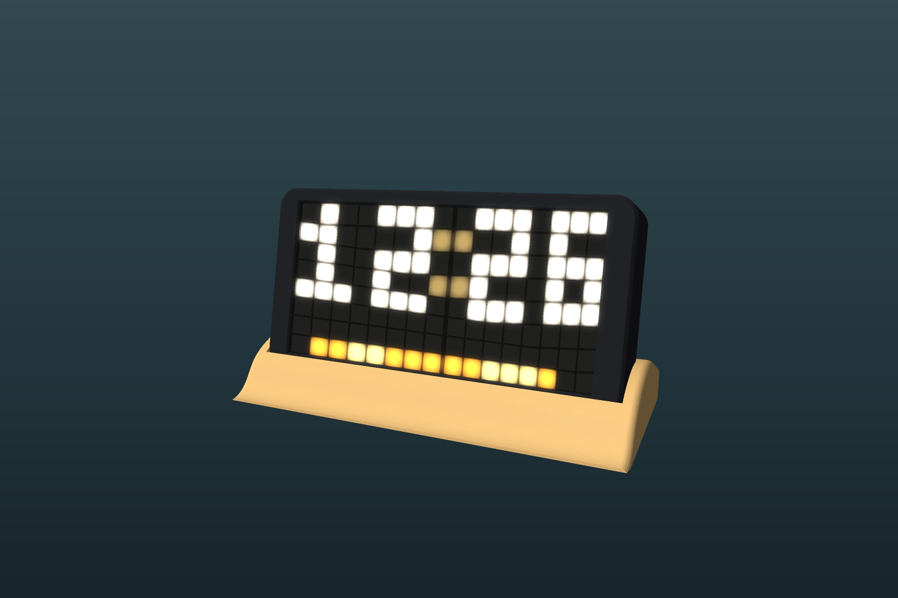
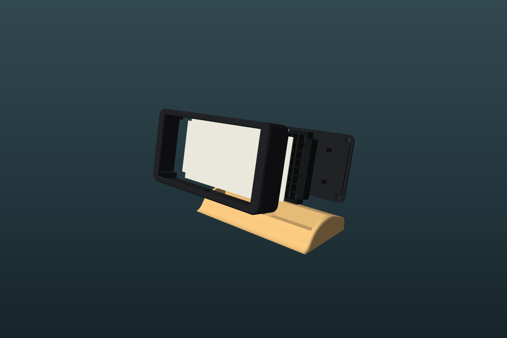

# Build your own Sandbar Clock

This guide takes you from a pile of parts to a working clock on your shelf. You'll need basic soldering skills and access to a 3D printer. You don't need to know how to program.



## What you need

### Electronics

| Qty | Part | Notes |
|---|---|---|
| 2 | 8×8 WS2812B LED panels | Rigid panels, about 65 × 65mm with 8mm between LEDs. The case only fits this size |
| 1 | ESP32-C3 SuperMini | The small board that runs the clock |
| 1 | Snap-in USB-C socket with two wires | 15.5 × 9mm flange and 11mm deep. Any other size needs a different opening in the base |
| 1 | 330Ω resistor | Protects the LED data line |
| 1 | 1000µF capacitor, 10V or higher | Optional, but it protects the LEDs at switch-on |
| 1 | 5V USB power supply, 2A or more | With a USB-A to USB-C cable (see [Troubleshooting](#troubleshooting) about USB-C to USB-C) |
| 4 | M3 countersunk self-tapping screws, 10–12mm | Hold the rear lid on |
| | Thin hook-up wire | 22–26 AWG in at least three colours |

### Tools and materials

- Soldering iron and solder
- Multimeter
- USB-C data cable, to program the board
- 3D printer with a 0.4mm nozzle
- Filament in your choice of colour, plus **white** for the diffuser
- Double-sided foam tape, or a little hot glue

## 1. Print the case

The STL files are in [`case/stl`](case/stl). They're already the right way up for printing, so don't rotate them. The parts are designed to print without supports.

| File | Filament | Notes |
|---|---|---|
| [`1_housing.stl`](case/stl/1_housing.stl) | Your colour | The front shell |
| [`2_light_grid.stl`](case/stl/2_light_grid.stl) | Black or another dark colour | Stops light spreading between LEDs. It has 0.8mm walls, so use a 0.4mm nozzle |
| [`3_diffuser_WHITE.stl`](case/stl/3_diffuser_WHITE.stl) | White | Only 0.8mm thick, so it lets the light through. Print at 0.2mm layers or finer |
| [`4_rear_lid.stl`](case/stl/4_rear_lid.stl) | Your colour | Holds the panels in place and has a cradle for the ESP32 |
| [`5_dune_base.stl`](case/stl/5_dune_base.stl) | Your colour | The stand, which holds the USB-C socket |
| [`6_socket_fit_test.stl`](case/stl/6_socket_fit_test.stl) | Any | A small test plate, described below |

**Print two test parts before the big ones:**

1. Print the light grid and lay it over your two panels, pushed together edge to edge. Every LED should sit inside its own cell.
2. Print the socket test plate and push your USB-C socket into each hole. Printers and sockets vary, and the middle hole is the same size as the one in the base. If a different hole fits better, change `SOCKET_HOLE_W` and `SOCKET_HOLE_H` in [`case/generate_case.py`](case/generate_case.py), which needs FreeCAD to run. The left and right holes are 0.4mm smaller and larger than the middle one.

If your panels have a break-off strip with mounting holes along one edge, remove it. The panels need to sit right up against each other.

## 2. Install the firmware

You'll put the firmware on the board before wiring anything, so that a problem with the board is easy to spot.

1. Install [Visual Studio Code](https://code.visualstudio.com/), then add the **PlatformIO IDE** extension from its Extensions panel.
2. Download this project with **Code → Download ZIP** on the repository page, then unzip it.
3. In VS Code, choose **File → Open Folder** and select the `firmware` folder.
4. *Recommended:* open `src/config.h` and change `SETUP_NETWORK_PASSWORD` to your own password of at least 8 characters. The default one is published in this guide.
5. Connect the ESP32-C3 to your computer with a USB-C data cable.
6. Select the **PlatformIO: Upload** arrow in the bottom bar of VS Code.

The first build downloads several hundred megabytes of tools and can take a good few minutes. It's finished when the terminal shows `SUCCESS`.

If you prefer the command line, run this from the `firmware` folder once PlatformIO is installed:

```bash
pio run -t upload
```

## 3. Wire it up on the bench

Unplug the board first. Connect everything on your bench before anything goes in the case, and make the wires long enough for the rear lid to lie open next to the housing.

```
                    +-----------------------+
USB-C socket        |                       |
 red   (+5V) --+----+--> 5V   LEFT panel    |
 black (GND) --|-+--+--> GND  (as seen      |
               | |  |    from the front)    |
               | |  |                       |
               | |  |    DIN <---[330R]---- GPIO 4 on ESP32-C3
               | |  |    DOUT --+           |
               | |  +-----------|-----------+
               | |              |
               | |  +-----------|-----------+
               +-|--+--> 5V     |           |
               | +--+--> GND    |  RIGHT    |
               | |  |    DIN <--+  panel    |
               | |  +-----------------------+
               | |
               +-|-----> 5V  on ESP32-C3
                 +-----> GND on ESP32-C3
```

| From | To |
|---|---|
| Socket red (+5V) | 5V on both panels and 5V on the ESP32-C3 |
| Socket black (GND) | GND on both panels and G on the ESP32-C3 |
| GPIO 4 on the ESP32-C3 | 330Ω resistor, then DIN on the left panel |
| DOUT on the left panel | DIN on the right panel |
| Capacitor (optional) | Across 5V and GND where power reaches the panels. The striped leg goes to GND |

- The arrows printed on most panels show which way the data runs, from DIN to DOUT.
- Keep the wires clear of the panel's small components, and keep the joints flat. The rear of the case is about 11mm deep.
- Solder wires straight onto the ESP32-C3 rather than fitting header pins, so it sits flat in its cradle.
- Check the socket with a multimeter before connecting it to anything. Plug it into your power supply and confirm that red is +5V.

> **Use one power source at a time.** Never plug in the ESP32-C3's own USB port and the USB-C socket together, as that connects two supplies to each other. Whenever you're reprogramming, unplug the socket first.

## 4. Check the panel layout

LED panels are wired differently from one maker to the next, so this test matches the firmware to yours.

1. In `firmware/src/config.h`, change `WIRING_TEST` to `true`.
2. Upload again, as in step 2.
3. Hold the panels side by side with the LEDs facing you and the left panel (the one wired to the ESP32) on your left.

Top-left should stay red and bottom-right should stay green. A white dot should walk from left to right along each row, from the top row down. If it doesn't, change these settings in `config.h`, then upload and look again:

| What you see | Change |
|---|---|
| The dot starts on the right panel | `LEFT_PANEL_FIRST = false` |
| Every other row runs backwards | Switch `PANEL_SERPENTINE` |
| The dot moves up and down on one panel | Switch `columns` for that panel in `PANELS` |
| A panel is mirrored left to right | Switch `flipX` for that panel |
| A panel is upside down | Switch `flipY` for that panel |

In `PANELS`, the first line is the left panel and the second is the right panel. The settings in this project are for a right panel mounted a quarter-turn from the left one, so yours may well need changing.

**When the dot moves correctly, set `WIRING_TEST` back to `false` and upload one more time.**

## 5. Put it in the case



Work from the back of the housing, with its front face down on a soft cloth. Remember that from this side, the clock's left panel is on your right.

1. **Fit the socket.** Push the socket's wires, then its body, through the opening in the back of the dune base from the outside, until the clips snap in and the flange sits against the wall. The wires come out where the screen will sit.
2. **Drop in the diffuser.** Lay it flat inside the housing, against the window.
3. **Add the light grid.** The flat side goes against the diffuser, and the side with the small pillars faces you.
4. **Add the panels.** Place them LEDs down so that each LED goes into a cell, and push them right together. There should be no gap at the join.
5. **Bring in the power.** Feed the socket's wires through the slot in the bottom wall of the housing, then join them to your 5V and GND wiring. The wires are 105mm long, so extend them if they don't reach. Cover every joint with heat-shrink or tape.
6. **Mount the ESP32-C3.** Fix it in the cradle on the inside of the lid with foam tape, with the USB port towards the cradle's open end. Keep its antenna end clear of the wiring where you can, for a better Wi-Fi signal.
7. **Close the lid.** Check no wires are trapped or sitting under the lid's posts, which press on the back of the panels. Fix the lid with the four M3 screws, stopping as soon as they're snug, because they're cutting into plastic.
8. **Stand it up.** Lower the screen into the slot in the base, feeding the spare wire into the space below it. If it's loose, add a few small dots of glue.

## 6. Connect it to Wi-Fi

1. Plug the USB-C socket into your power supply. With no saved network, the clock shows four dashes and a blue dot.
2. On your phone or laptop, join the **Sandbar-Clock-Setup** Wi-Fi network. The password is `sandbar1234`, unless you changed it in step 2.
3. The setup page should open by itself. If it doesn't, go to `http://192.168.4.1`.
4. Under **Wi-Fi and timezone**, choose your network, enter its password and pick your timezone, then save. The network must be 2.4 GHz.

The clock restarts and joins your network. The dot turns green, then the time appears.

## 7. Enjoy your clock

To reach the settings page, go to `http://sandbar-clock.local` from any device on your network. If that doesn't load, use the clock's IP address, which you can find on your router's device list.

- **Clock face:** choose from 56 faces, grouped by category. **Shuffle** picks a new one every hour.
- **Brightness:** drag the slider. The display still dims automatically at night.
- **Location:** enter your latitude and longitude for the Weather window, Real sun and moon, and Tide line faces. The clock fetches this data from Open-Meteo.

The page has no login, so anyone on your home network can change the clock's settings.

## Troubleshooting

| Problem | What to try |
|---|---|
| No LEDs light up | Check the data wire goes to **DIN** rather than DOUT, that all grounds are connected, and that the panels are getting 5V at their pads |
| Only the left panel lights | Check the wire from the left panel's DOUT to the right panel's DIN, and that the right panel has 5V and GND |
| Digits look scrambled | Repeat [step 4](#4-check-the-panel-layout) |
| The computer doesn't see the board | Try another USB cable, because many only carry power |
| Upload won't start | Hold **BOOT** on the board, tap **RESET**, release **BOOT**, then upload again |
| The build stops with `internal compiler error` | Run the upload again. This error comes and goes |
| Windows blocks the build tools | Smart App Control can stop PlatformIO from running. That's a Windows security setting, so decide for yourself whether to change it, or build on another computer |
| A USB-C to USB-C charger won't power it | Some sockets lack the resistors these chargers look for. Use a USB-A to USB-C cable |
| The clock can't find the network | It must be 2.4 GHz. The clock opens its setup network again if it can't connect within 20 seconds |
| `sandbar-clock.local` won't open | Some devices don't support `.local` addresses, so use the IP address |
| The LEDs flicker or the board restarts | Use a stronger power supply. Leave `MAX_MILLIAMPS` in `config.h` at 1500 or lower for a 2A supply |

## Going further

- **Using an ESP32-S3:** add `-e esp32s3` to the upload command and connect the data wire to GPIO 12. Change `-DLED_PIN` in `platformio.ini` to use a different pin. On some S3 boards, the `5V` pin isn't connected unless the `IN-OUT` solder jumper is bridged.
- **Different panels:** change the dimensions at the top of [`case/generate_case.py`](case/generate_case.py) and run it with FreeCAD's `FreeCADCmd` to generate new parts.
- **More about the firmware:** see the [firmware README](firmware/README.md).
