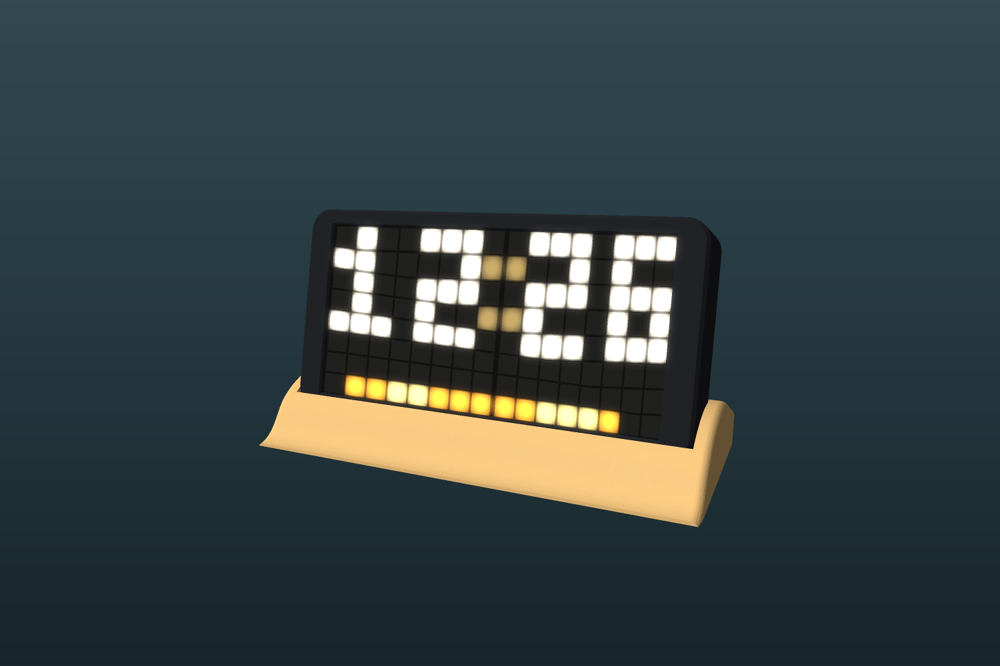

# Sandbar Clock

A shelf clock built from two 8x8 WS2812B panels and an ESP32-C3 SuperMini, with 56 selectable faces, a Wi-Fi setup page and a 3D-printable case.

**Want to make one?** Follow the [build guide](BUILD_GUIDE.md) for the parts list, printing, wiring, firmware and assembly.

## What's here

- `firmware/`: the PlatformIO project. See [its README](firmware/README.md) for wiring, setup and the list of faces.
- `case/stl/`: the parts to print.
- `case/generate_case.py`: the FreeCAD script that generates the parts. Dimensions are at the top of the file.
- `case/sandbar_case_parts.step`: the case parts for use in other CAD software.

## Printing the case

| File | Notes |
|---|---|
| `1_housing.stl` | Front shell |
| `2_light_grid.stl` | Separates the LEDs. Tested on the real panels at 8.0mm LED spacing |
| `3_diffuser_WHITE.stl` | Print in white |
| `4_rear_lid.stl` | Fixes on with M3 self-tapping screws |
| `5_dune_base.stl` | Stand, with an opening for a snap-in USB-C socket |
| `6_socket_fit_test.stl` | Optional plate for checking the socket fit. The middle hole matches the base |

The socket opening is 13.8 x 7.1mm, in a 2mm wall, for a socket with a 15.5 x 9mm flange.
